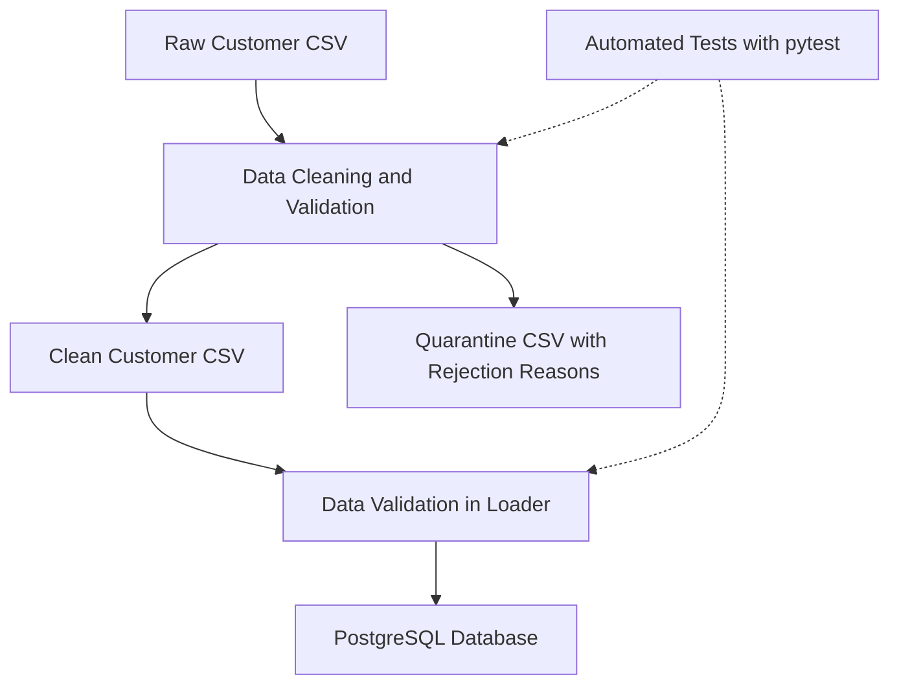

# ShopSphere — Data Engineering Project

ShopSphere is a beginner-friendly data engineering project that demonstrates how to build a small, reliable data pipeline using Python and PostgreSQL.

The project takes raw customer data in CSV format, cleans and validates the records, separates invalid or duplicate records into a quarantine file, and loads valid customer data into a PostgreSQL database.

## Project Goals

- Clean and standardize raw customer data.
- Identify and quarantine invalid, incomplete, and duplicate records.
- Load validated data into PostgreSQL.
- Build a reusable pipeline for data cleaning and loading.
- Handle failures safely and prevent duplicate database inserts.
- Validate pipeline behavior using automated tests.

## Tech Stack

| Technology | Purpose |
|---|---|
| Python 3.11 | Data pipeline development |
| Pandas | Data cleaning and transformation |
| PostgreSQL | Storing validated customer records |
| psycopg2 | Connecting Python to PostgreSQL |
| python-dotenv | Loading database configuration from environment variables |
| pytest | Automated testing |
| Git and GitHub | Version control and project hosting |
| VS Code | Development environment |

## Project Structure

```text
ShopSphere-Project/
├── data/
│   ├── clean/          # Cleaned customer data
│   └── quarantine/     # Rejected records and reasons
├── src/
│   ├── inspect_data.py # Data cleaning and validation
│   ├── load_customers.py # PostgreSQL loading and validation
│   └── run_pipeline.py # Runs the pipeline steps
├── tests/
│   └── test_pipeline.py # Automated pipeline tests
├── .env                # Local database configuration (not committed)
├── .gitignore          # Files excluded from Git
├── README.md           # Project documentation
└── requirements.txt    # Python dependencies, if present
```

*Note: The `data/clean/` and `data/quarantine/` folders contain generated outputs. They may not appear in a fresh GitHub checkout because they are excluded by `.gitignore`.

## How the Pipeline Works

ShopSphere follows a simple data engineering workflow:

1. **Extract:** Read raw customer records from `data/customers_dirty.csv`.
2. **Transform:** Clean customer names, standardize city names, validate required fields, and check signup dates.
3. **Quarantine:** Separate rejected records into `data/quarantine/customers_quarantine.csv`, along with reasons explaining why they were rejected.
4. **Reconcile:** Account for the raw records across the clean and quarantine outputs without double-counting overlapping data-quality issues.
5. **Load:** Insert valid customer records into the `public.shopsphere_customers` PostgreSQL table.
6. **Handle failures:** Log errors and roll back failed database transactions.
7. **Test:** Use pytest to verify cleaning, validation, pipeline failures, and database-loading behavior.

### Running the Pipeline

From the project root, run:

```bash
python -m src.run_pipeline
```

The pipeline runs data cleaning and quarantine first, followed by loading the clean records into PostgreSQL.

### Running the Tests

Run the automated test suite with:

```bash
python -m pytest -v
```

The current test suite contains 14 tests.

## Setup and Configuration

### 1. Prerequisites

Before running ShopSphere, install:

- Python 3.11 or later
- PostgreSQL
- Git

### 2. Clone the Repository

```bash
git clone https://github.com/Shreyadiddi/ShopSphere-Project.git
cd ShopSphere-Project
```

### 3. Create and Activate a Virtual Environment

On Windows PowerShell:

```powershell
python -m venv .venv
.\.venv\Scripts\Activate.ps1
```

### 4. Install Dependencies

Install the project's required Python packages. If a `requirements.txt` file is available, run:

```powershell
pip install -r requirements.txt
```

### 5. Configure Environment Variables

Create a `.env` file in the project root and add your local PostgreSQL connection settings:

```dotenv
DB_HOST=localhost
DB_PORT=5432
DB_NAME=ShopSphere
DB_USER=your_postgres_username
DB_PASSWORD=your_postgres_password
```

Replace the example username and password with your own local PostgreSQL credentials.

**Security:** Never commit your `.env` file or share database passwords publicly.

### 6. Prepare the Database

Create a PostgreSQL database named `ShopSphere`, then create the customer table:

```sql
CREATE TABLE public.shopsphere_customers (
    customer_id INTEGER PRIMARY KEY,
    customer_name VARCHAR(100) NOT NULL,
    city VARCHAR(100) NOT NULL,
    signup_date DATE NOT NULL
);
```

### 7. Run the Pipeline

Place the raw input CSV at `data/customers_dirty.csv`, then run:

```powershell
python -m src.run_pipeline
```

### 8. Run Automated Tests

```powershell
python -m pytest -v
```

## Architecture



### Data Quality and Reliability

- Invalid signup dates and records with missing required fields are quarantined.
- Duplicate records are identified and handled according to the project's cleaning rules.
- Clean records are validated again before database loading.
- Database transactions are rolled back if loading fails.
- Automated tests verify expected behavior and error-handling scenarios.